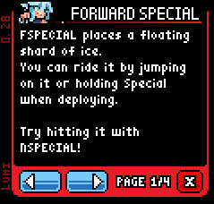

# Custom Infobox
(and theoretically other custom pages on CSS)

<p align="center">

</p>

## Why?

Currently in online play, the infobox built into Rivals just **does not work.** It cannot display a page other than the first page. Also, I happen to dislike how little text can actually be displayed per page. That part's opinionated.

The big thing that was in the way of doing something like this was that there wasn't a good way to hide the existing buttons and playtest prompt on the CSS, the only way you can hide that stuff is by moving it offscreen. If you swapped characters or reloaded, whoops! It's offscreen forever now.

Turns out all you needed was a game of tug of war.

## Installation

... oh boy. So, while this is a 'template' and is free to use, there's one tiny little hurdle. You probably already have CSS draw code from some other character like [Tester the Template Man by Bar-Kun][tester].

This "template" requires you to adapt/isolate most of that code, since it relies on a "state machine" (it's just a switch statement). Additionally, you need to make sure that whatever article you assign it to isn't running any code in its init that you wouldn't want to run without the character.

Anyway.

1. Back up your `css_init.gml`, `css_draw.gml`, and `css_update.gml` if you already have them.

2. Download the assets from [my Drive folder](https://drive.google.com/drive/folders/1EpBjMkU82sAMSsO9L7TutQYHnQgvkR9r?usp=sharing), or from here on GitHub, though the files were provided on drive for convenience.

3. Copy the scripts provided in the scripts folder to your character's scripts folder.

4. In `css_draw.gml` and `css_update.gml`, copy the code from your original `css_draw.gml` and `css_update.gml` into `case 0:` of the switch statements in the new code. If you did not already have any css scripts, skip to step 5.

5. In `css_init.gml`, copy your original `css_init.gml` code to the bottom of the script.

6. Copy the sprites provided in the sprites folder to your character's sprites folder.

7. Edit `css_infobox_preview.png` to a 2x crop of your character within the given dimensions. Although, what you use here doesn't actually matter. Do what you like!

## Usage

In `css_init.gml`, there is a region titled `Infobox Text`. You can set the text there. Theoretically, there is no limit to the number of pages you can have. Just add a new header and a new text entry if you need one.

If you want to add an additional custom menu like this, you'll have to add a button for it. After that, add a new case in `css_draw.gml` and `css_update.gml` with your new CSS menu. As a jumping off point, you can use...
```gml
// css_update.gml
case 2:
    var temp_y = ystart;
    drawing_custom = true;
    suppress_cursor = true;

    // If the cancel button is pressed, return to the regular CSS state.
    if (menu_b_pressed) {
		css_state = 0;
		drawing_custom = false;
		sound_play(asset_get("mfx_return_cursor"), false, 0);
		break;
	}
    // do whatever you want
    break;
```
```gml
// css_draw.gml
case 2:
    var temp_y = ystart
    // draw your custom UI
    break;
```
`temp_y` is a corrected `y` coordinate, since the `y` of the object has been moved down 20000 units.

`drawing_custom` is the variable that tells the article to push the object off screen, so the base game buttons don't overlap the custom UI.

`suppress_cursor` is the built-in variable that prevents your inputs from interacting with (most) buttons on the CSS, letting you safely use button inputs.

[For more info about the character select screen, see here.][css-on-wiki]

[tester]:https://steamcommunity.com/sharedfiles/filedetails/?id=2859046287
[css-on-wiki]:https://rivalswsmanual.miraheze.org/wiki/Character_Select_Screen